# シーケンス図

本ドキュメントでは、主要なユースケースにおけるドメインイベントの発行とハンドリングのフローを図示する。

マルチテナント（1家族 = 1テナント）のため、認証後の全ユースケースは「JWTから取り出した`tenantId`を`Input`に載せ、`Database.withTransaction(tenantId)`の中で処理する」形になっている（テナントを指定しないDB接続は`Database`には存在しない）。

---

## 概要：ドメインイベントフロー

イベントの流れは2系統ある。

- **同一トランザクション内（インメモリ）**: `TaskDefinitionCreated`・`TaskExecution*`系。`DomainEventDispatcher`がコミット前にハンドラを同期実行する。
- **outbox経由（非同期）**: `TaskDefinitionDeleted`のみ。同一トランザクション内でoutboxに書き、コミット後に別経路で処理する。

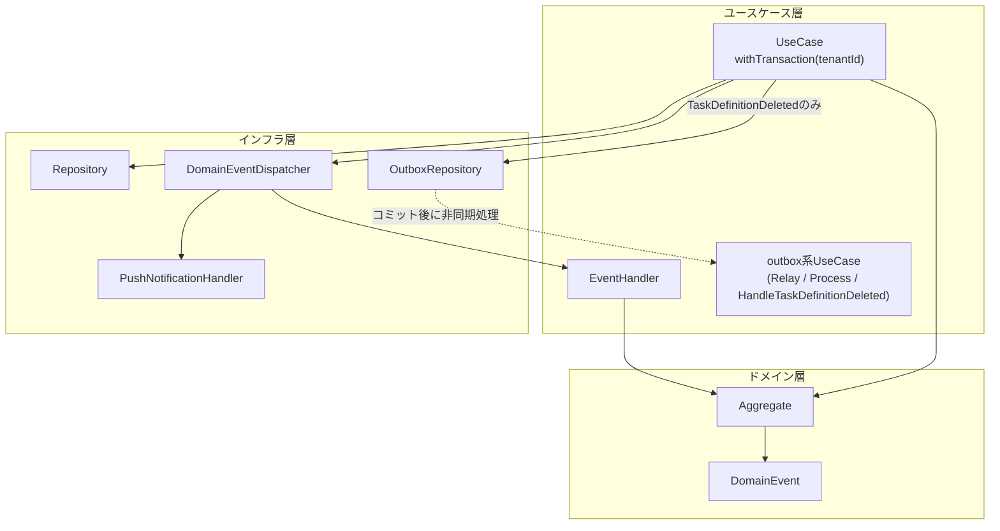

---

## 認証とテナント（前提）

### サインアップ = 家族（テナント）の作成

`POST /api/auth/register`で、テナントと最初のメンバーを1トランザクションで作成する。テナント作成はテナント確定前の処理で、`tenants`への書き込みは`housework_app`に許可されていない（V24）ため、RLSを越えるオーナー接続`DatabaseWithoutRLS`を使う。

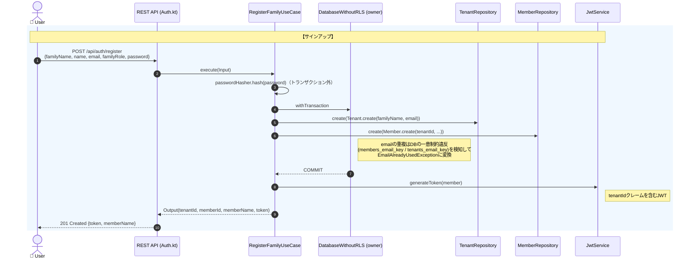

### ログイン（emailで認証）

emailはテナントをまたいでグローバルに一意なので、テナント確定前に全テナントからメンバーを探す必要があり、ここでもオーナー接続を使う。

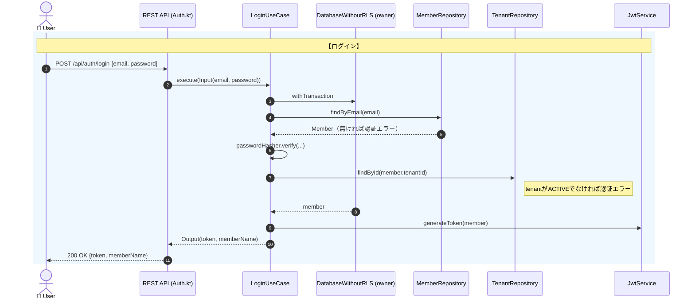

認証エラーは失敗理由によらず同一メッセージで`401`を返す（アカウントの存在有無を推測させないため）。

### 認証後のリクエスト共通の流れ

認証後のルートは`call.authenticatedMember()`で`AuthenticatedMember(memberId, tenantId)`をJWTから取り出し、`tenantId`を各UseCaseの`Input`に載せて渡す。`tenantId`をリクエストボディから受け取ることはない（例: `POST /api/member/create`もJWT由来のテナントにメンバーを追加する）。

以降のUC-1〜UC-6はこの前提で、図中の`withTransaction(tenantId)`は`housework_app`プール（RLS適用）で、トランザクションの先頭に`set_config('app.current_tenant_id', ?, true)`を実行する処理を指す。

---

## UC-1: タスク定義の作成

ユーザーがタスク定義を作成すると、`TaskDefinitionCreated`イベントが発行され、条件に応じてタスク実行が自動生成される。

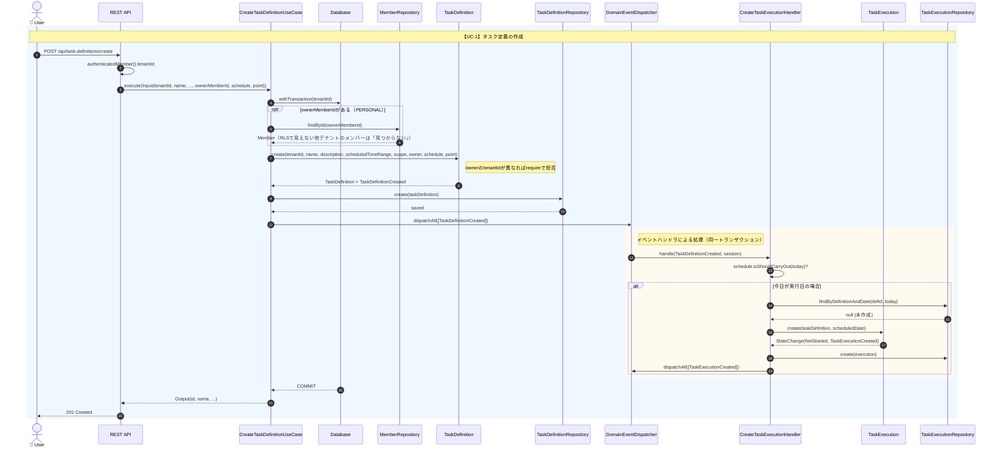

---

## UC-2: 定期タスクの日次生成（スケジューラ）

毎朝6:00に`DailyTaskGenerationScheduler`が起動し、`TenantBatchRunner`で有効な（ACTIVEな）全テナントを列挙して、**テナントごとに1回ずつ**`GenerateDailyExecutionsUseCase`を呼ぶ。1テナントの失敗は他テナントに影響せず、結果は成功・失敗の件数としてログに出る。

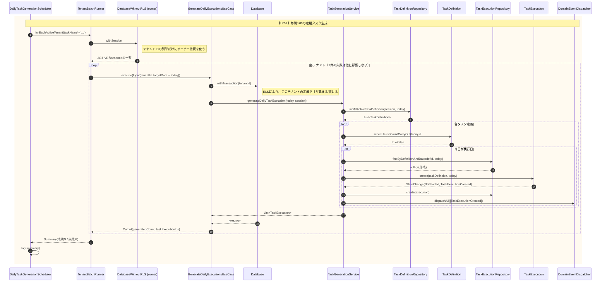

手動生成API（`POST /api/task-generations/daily`、`/daily/{date}`）は、ログイン中メンバーのテナントに対してのみ同じ`GenerateDailyExecutionsUseCase`を1回呼ぶ。

---

## UC-3: タスクの開始

メンバーがタスクを開始すると、`TaskExecutionStarted`イベントが発行され、FAMILYスコープの場合は他の家族メンバーにプッシュ通知が送信される。

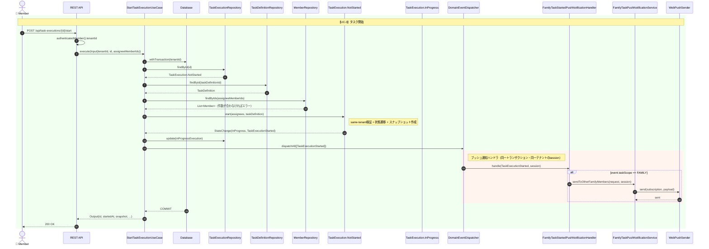

---

## UC-4: タスクの完了

メンバーがタスクを完了すると、`TaskExecutionCompleted`イベントが発行され、参加者にポイントが付与される。FAMILYスコープの場合はプッシュ通知も送信される。

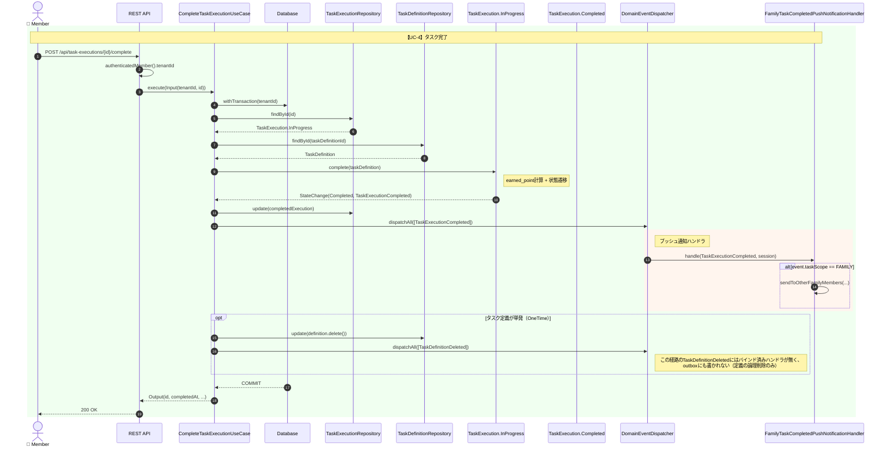

---

## UC-5: タスクのキャンセル

メンバーがタスクをキャンセルすると、`TaskExecutionCancelled`イベントが発行される。

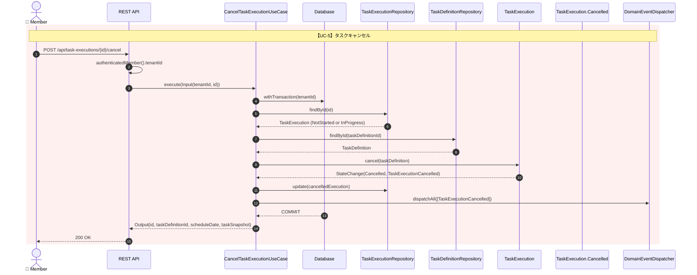

---

## UC-6: タスク定義の削除

タスク定義を論理削除すると、`TaskDefinitionDeleted`イベントを**outbox**に書き込む（同一トランザクション）。関連する未完了のタスク実行（NotStarted / InProgress）のキャンセルは、コミット後に非同期で行われる。

### UC-6a: 削除リクエスト（outboxへの書き込み）

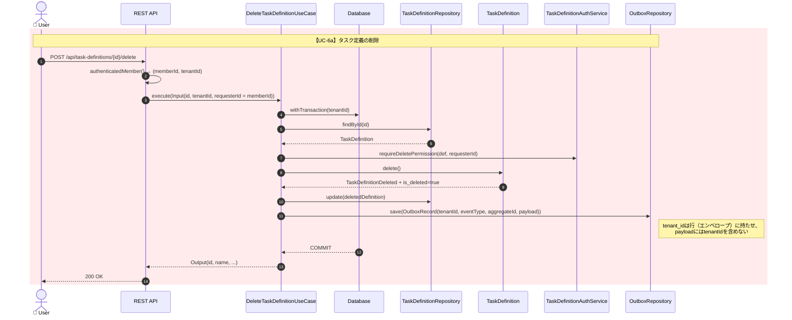

### UC-6b: outboxの処理（`pubsub.enabled`で2モード）

`OutboxEventProcessorScheduler`が10秒間隔で起動し、`pubsub.enabled`（既定`false`、環境変数`PUBSUB_ENABLED`）で処理方式を切り替える。どちらのモードも、実際の処理は`OutboxEventProcessor` → `HandleTaskDefinitionDeletedUseCase`が行う。

- **`pubsub.enabled=true`（リレー方式）**: `RelayOutboxEventsUseCase`がPENDING行をPub/Subのトピック`domain-events`へpublishするだけ。アプリ内の`DomainEventSubscriber`（streaming pull）が受信して処理する。
- **`pubsub.enabled=false`（アプリ内処理方式）**: `ProcessOutboxEventsUseCase`がPENDING行を直接ポーリングして処理する。

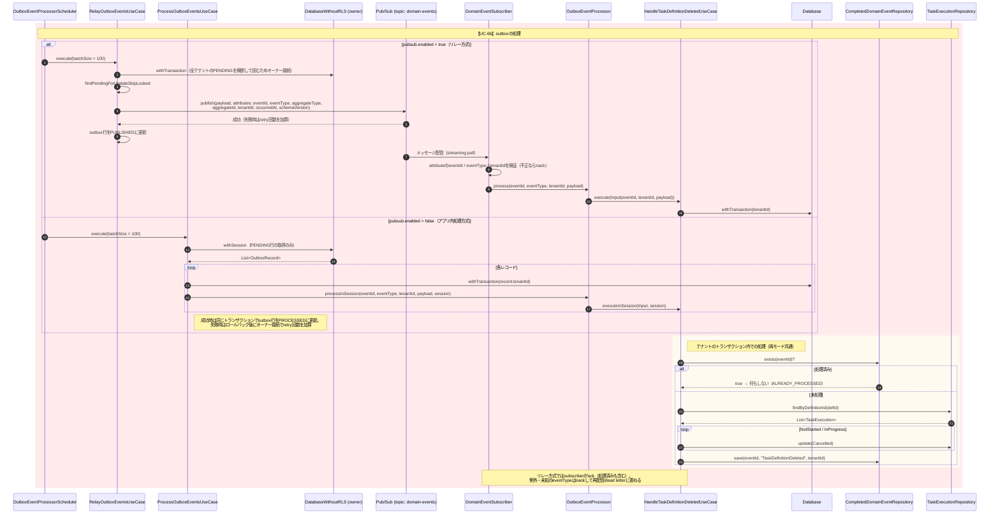

配信はat-least-once前提であり、二重処理は`completed_domain_events`の`event_id`存在チェックで吸収する（冪等性）。

---

## 状態遷移図：TaskExecution

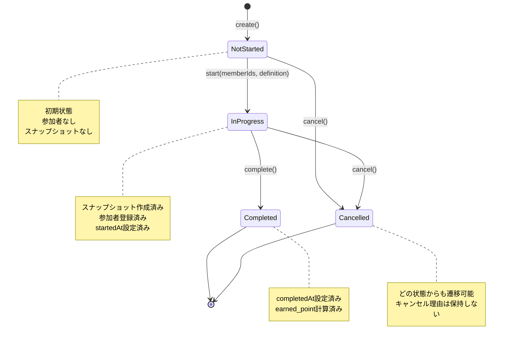

---

## ドメインイベント一覧

| イベント | 発行元 | トリガー | ハンドラ |
|---------|--------|----------|----------|
| `TaskDefinitionCreated` | TaskDefinition.create() | タスク定義作成 | CreateTaskExecutionOnTaskDefinitionCreatedHandler（同一トランザクション） |
| `TaskDefinitionDeleted` | TaskDefinition.delete() | タスク定義削除 | outbox経由で`HandleTaskDefinitionDeletedUseCase`（コミット後に非同期、UC-6参照） |
| `TaskExecutionCreated` | TaskExecution.create() | タスク実行生成 | (なし) |
| `TaskExecutionStarted` | TaskExecution.NotStarted.start() | タスク開始 | FamilyTaskStartedPushNotificationHandler |
| `TaskExecutionCompleted` | TaskExecution.InProgress.complete() | タスク完了 | FamilyTaskCompletedPushNotificationHandler |
| `TaskExecutionCancelled` | TaskExecution.cancel() | タスクキャンセル | (なし) |

---

## UC-7: 通知バッチ（未完了通知・リマインダー・翌日通知）

`DailyNotCompletedTaskNotificationScheduler`（19:00）、`NotDailyTaskReminderScheduler`、`NotDailyTomorrowTaskNotificationScheduler`は、UC-2と同様に`TenantBatchRunner.forEachActiveTenant`でテナントごとにUseCaseを1回ずつ呼ぶ（`SendDailyNotCompletedTaskNotificationsUseCase` / `SendNotDailyTaskRemindersUseCase` / `SendNotDailyTomorrowTaskNotificationsUseCase`）。各テナントの処理は次の3段で、外部HTTP通信（Web Push）の間はDB接続を握らない。

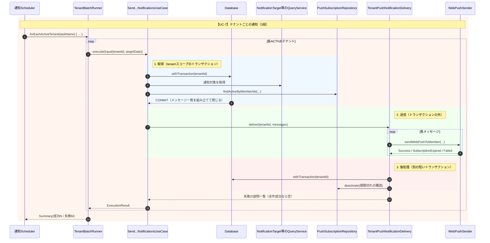

---

## イベント発行タイミング

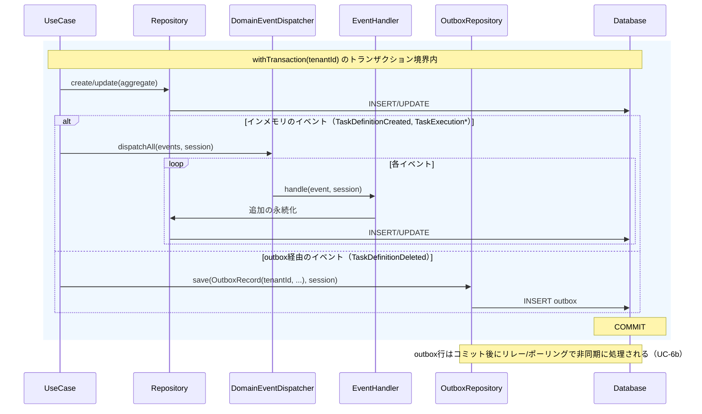

**重要**:
- インメモリのイベントハンドラは同一トランザクション内で実行されるため、ハンドラ内の処理が失敗するとトランザクション全体がロールバックされる（強整合性）。ただしプッシュ通知ハンドラは送信失敗を握りつぶしてログに残すだけで、ロールバックしない。
- outbox経由のイベント（`TaskDefinitionDeleted`）は、outboxへの書き込みまでが同一トランザクションで、後続のタスク実行キャンセルはコミット後に別トランザクションで行われる（結果整合性）。
